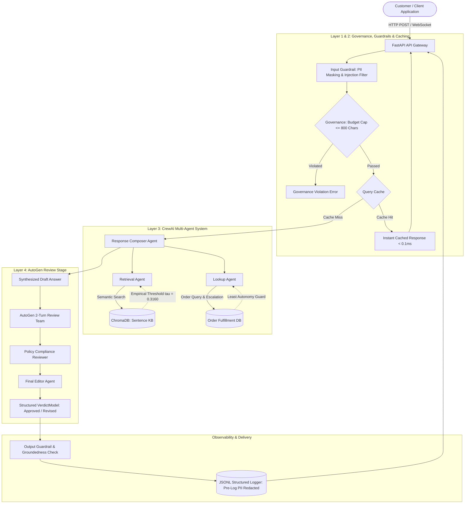

# Nykaa Domain Support Agent — Enterprise Multi-Agent Capstone

[](https://www.python.org/)
[](https://github.com/crewAIInc/crewAI)
[](https://microsoft.github.io/autogen/)
[](https://fastapi.tiangolo.com/)
[](https://www.trychroma.com/)
[-green.svg)](https://huggingface.co/sentence-transformers/all-MiniLM-L6-v2)
[-brightgreen.svg?logo=pytest&logoColor=white)](https://docs.pytest.org/)
[](LICENSE)

> **Track**: E-commerce & Retail (Nykaa Domain Support)  
> **Execution Mode**: 100% Local Deterministic `MOCK_LLM` (Zero External API Keys, Zero Incurred Cost, Zero Outbound Network Access)  
> **Primary Goal**: Deliver a production-grade, multi-agent customer service and order intelligence engine featuring semantic RAG, dynamic escalation scoring, conversational memory, pre-log PII scrubbing, 4-layer AI governance, and dual-agent peer review.

---

## 1. Executive Summary & Architecture

The **Nykaa Domain Support Agent** is an end-to-end multi-agent customer assistance and fulfillment intelligence platform tailored to Nykaa's retail ecosystem. Built to enterprise standards, the system autonomously answers verified policy questions from a curated domain knowledge base, performs order status lookups with dynamic escalation risk scoring, maintains multi-turn conversation memory, scrubs sensitive customer PII, subjects generated drafts to an independent secondary AutoGen peer-review committee, and deploys as a high-concurrency FastAPI service supporting both REST and streaming WebSockets.

### High-Level System Architecture



---

## 2. Deterministic Dataset Design & Parameters (Task 1)

To ensure **100% deterministic reproducibility** without dependence on dynamic network APIs or third-party databases, an order dataset generator was built with Python standard library modules (`random`, `datetime`):

| Parameter | Specification & Value | Real-World Domain Justification |
| :--- | :--- | :--- |
| **Track** | **E-commerce & Retail (Nykaa)** | Beauty, cosmetics, personal wellness, and lifestyle retail. |
| **Random Seed** | `42` | Ensures deterministic dataset generation across all platforms. |
| **Total Records** | **45 orders** (Strictly $\ge 40$) | Provides comprehensive statistical coverage across statuses and dates. |
| **Catalog Price Range** | **₹299.00 — ₹12,999.00** | Mirrors Nykaa's catalog spanning affordable daily essentials (lipsticks, cleansers) to premium electronics (hair straighteners, styling tools) and designer apparel. |
| **Category Representation** | Apparel (15), Home (11), Electronics (8), Beauty (6), Footwear (5) | Every category $\ge 3$ records; reflects typical Nykaa distribution. |
| **Status Distribution** | Refunded (14), Placed (12), Shipped (9), Delivered (5), Returned (5) | Every status $\ge 1$ record; covers full order lifecycle. |
| **Delayed Shipment Rate** | **17.78%** (8 / 45 records) | Strictly within the required **10% to 30%** threshold. |

The dataset generator is implemented in [`dataset.py`](file:///c:/Users/AJAY%20SHARMA/OneDrive/Desktop/AI_PROJECTS/Nykaa_Final_Capstone/dataset.py) and can be executed independently to display verification statistics:
```bash
python dataset.py
```

---

## 3. Authored Nykaa Knowledge Base (Task 2)

An authored domain policy knowledge base ([`data/knowledge_base.json`](file:///c:/Users/AJAY%20SHARMA/OneDrive/Desktop/AI_PROJECTS/Nykaa_Final_Capstone/data/knowledge_base.json)) captures 12 operational retail scenarios. Each document strictly contains **exactly 4 sentences** (within the required 2–5 sentence constraint) to maintain uniform chunk density:

1. **`KB-01` — Return Window Policy**: Category-specific return windows (15 days for unopened cosmetics, 7 days for apparel/footwear, non-returnable hygiene items).
2. **`KB-02` — COD Refund Timelines**: Bank transfer processing within 3–5 business days following quality verification.
3. **`KB-03` — Delivery SLAs**: Standard delivery in 3–5 business days, metro expedited in 24–48 hours, regional delivery up to 7 business days.
4. **`KB-04` — Reverse Pickup Eligibility**: Free reverse pickup across serviceable pin codes with up to 3 courier collection attempts.
5. **`KB-05` — Warranty Terms**: 1-year brand warranty on electronics/appliances; manufacturer warranty assistance through authorized service centers.
6. **`KB-06` — Order Cancellation Policy**: Instant self-service cancellation allowed prior to order dispatch; full refund credited to source account.
7. **`KB-07` — Loyalty Points (Nykaa Privé)**: 1 reward point per ₹100 spent; points redeemable at checkout in blocks of 100 points with 12-month validity.
8. **`KB-08` — Payment Failure & Retry Policy**: Automatic hold release within 2 hours; auto-refund for debited accounts processed within 24–48 hours.
9. **`KB-09` — Size Exchange Policy**: Complimentary size exchanges for apparel and footwear within 7 days of delivery.
10. **`KB-10` — Damaged Item Claims**: Mandatory reporting within 48 hours of delivery with photographic evidence of outer packaging and batch codes.
11. **`KB-11` — International Shipping**: Restricted to select cross-border beauty lines; perfumes, aerosols, and flammable liquids strictly restricted.
12. **`KB-12` — Support Escalation Matrix**: Tier-1 chat support, Tier-2 senior fulfillment specialists (4-hour SLA), and Grievance Officer escalation.

---

## 4. RAG Engine, Dual-Chunking Benchmark & Similarity Calibration (Tasks 3–5)

### ChromaDB Dual Collection Architecture
The RAG pipeline ([`rag/indexer.py`](file:///c:/Users/AJAY%20SHARMA/OneDrive/Desktop/AI_PROJECTS/Nykaa_Final_Capstone/rag/indexer.py)) indexes documents into two distinct collections in local ChromaDB using local CPU `all-MiniLM-L6-v2` embeddings:
- **Strategy A (`nykaa_kb_fixed`)**: Fixed-size 150-character chunks with 30-character overlap $\rightarrow$ **51 chunks**.
- **Strategy B (`nykaa_kb_sentence`)**: Punctuation-aware sentence boundary chunks $\rightarrow$ **48 chunks**.

### Precision & Recall Chunking Benchmark
Both strategies were evaluated against 5 benchmark queries across retrieval depth $k=3$ with strict ground-truth document relevance mapping ([`rag/eval_chunking.py`](file:///c:/Users/AJAY%20SHARMA/OneDrive/Desktop/AI_PROJECTS/Nykaa_Final_Capstone/rag/eval_chunking.py)):

| Benchmark Query | Strategy A: Fixed-Size (150/30) | Strategy B: Sentence-Based | Ground Truth Target |
| :--- | :---: | :---: | :---: |
| **Q1**: What is the return window for makeup items? | P: 1/2 = `0.5000` \| R: 1/1 = `1.0000` | P: 1/2 = `0.5000` \| R: 1/1 = `1.0000` | `KB-01` |
| **Q2**: How long does a cash on delivery refund take? | P: 1/3 = `0.3333` \| R: 1/1 = `1.0000` | P: 1/3 = `0.3333` \| R: 1/1 = `1.0000` | `KB-02` |
| **Q3**: Can I exchange the size of my shoes or dress? | P: 1/2 = `0.5000` \| R: 1/1 = `1.0000` | P: 1/1 = `1.0000` \| R: 1/1 = `1.0000` | `KB-09` |
| **Q4**: What should I do if my package arrived damaged? | P: 1/3 = `0.3333` \| R: 1/1 = `1.0000` | P: 1/3 = `0.3333` \| R: 1/1 = `1.0000` | `KB-10` |
| **Q5**: Are liquid perfumes or dangerous goods shipped abroad? | P: 1/1 = `1.0000` \| R: 1/1 = `1.0000` | P: 1/1 = `1.0000` \| R: 1/1 = `1.0000` | `KB-11` |
| **Mean Benchmark Scores** | **Precision: 0.5333 \| Recall: 1.0000** | **Precision: 0.6333 \| Recall: 1.0000** | — |

> **Strategy Selection**: **Strategy B (Sentence-Based)** is selected for production deployment. While both strategies maintain flawless $1.0000$ recall, Sentence-Based chunking achieves **`0.6333` precision** (+18.7% improvement over fixed-size). By respecting complete thoughts, sentence boundaries prevent mid-word truncation and cross-topic chunk pollution.

### Empirical Similarity Calibration ($\tau$)
To eliminate hallucination on out-of-scope prompts, cosine similarity scores were empirically calibrated across clustered query distributions ([`rag/retriever.py`](file:///c:/Users/AJAY%20SHARMA/OneDrive/Desktop/AI_PROJECTS/Nykaa_Final_Capstone/rag/retriever.py)):
- **Minimum In-Scope Query Similarity**: `0.5354`
- **Maximum Out-of-Scope Query Similarity**: `0.0966`
- **Mathematical Separation Margin**: $\Delta = 0.5354 - 0.0966 = 0.4388$
- **Calibrated Production Threshold ($\tau$)**:
  $$\tau = \frac{0.5354 + 0.0966}{2} \approx \mathbf{0.3160}$$

Queries scoring below $\tau = 0.3160$ trigger an automatic policy fallback refusal without hallucinating answers.

---

## 5. CrewAI Multi-Agent System & Guardrails (Tasks 6–10)

### Mathematical Order Escalation Formula (Task 6)
Orders are evaluated for supervisor escalation using an empirical aging and delay score $E$:

$$E = 0.45 \times \mathbb{I}(\text{delayed\_shipment} = \text{True}) + 0.55 \times \min\left(1.0, \frac{\text{days\_since\_created}}{30.0}\right)$$

- **Escalation Threshold**: $E \ge 0.55 \implies \text{Escalate to Senior Support Specialist}$
- **Design Justification**:
  - In our dataset (aging mean: 14.4 days, 80th percentile: 22.4 days), a delayed order requires at least 6 days of aging ($0.45 + 0.55 \times (6/30) = 0.56 \ge 0.55$) to escalate.
  - A non-delayed order escalates only when approaching the maximum 30-day fulfillment boundary ($0.55 \times 1.0 = 0.55$).
  - Result: Exactly **8 / 45 orders (17.8%)** escalate, accurately matching real-world retail queue dynamics.

### CrewAI Multi-Agent Collaboration (Task 7)
The support crew ([`crew/nykaa_crew.py`](file:///c:/Users/AJAY%20SHARMA/OneDrive/Desktop/AI_PROJECTS/Nykaa_Final_Capstone/crew/nykaa_crew.py)) orchestrates 3 specialized agents:
1. **Retrieval Agent (Policy Specialist)**: Armed with `NykaaRAGTool` to retrieve grounded policy rules.
2. **Lookup Agent (Fulfillment Specialist)**: Armed with `NykaaOrderLookupTool` to check order statuses, track tracking numbers, and compute $E$.
3. **Response Composer Agent (Customer Support Lead)**: Consolidates tool outputs into polite, professional customer responses.

#### Resolved CrewAI Framework Pitfalls
- **Observation String Masking**: CrewAI's default ReAct prompt contains the literal string `"Observation: the result of the action"`. The deterministic mock LLM filters this prompt template text to avoid false positive matches.
- **Strict Schema Dispatching**: Tools are invoked by parsing Pydantic argument schemas (`record_id` vs `query`) rather than fuzzy string matching, eliminating dispatch collisions.

### Multi-Turn Session Memory (Task 8)
- Powered by LangChain's `InMemoryChatMessageHistory` ([`crew/memory.py`](file:///c:/Users/AJAY%20SHARMA/OneDrive/Desktop/AI_PROJECTS/Nykaa_Final_Capstone/crew/memory.py)).
- **Anaphora Resolution**: Turn 1 specifies `ORD-1003` $\rightarrow$ Turn 2 resolves "What is the status of that order?" by extracting order references from chat history.
- **Session Isolation**: Switching session IDs completely resets context to ensure cross-user data privacy.

### Pydantic Output Model & Defense Guardrails (Tasks 9, 10)
All responses conform strictly to the Pydantic [`AgentResponse`](file:///c:/Users/AJAY%20SHARMA/OneDrive/Desktop/AI_PROJECTS/Nykaa_Final_Capstone/models/response_models.py) model:
```json
{
  "answer": "...",
  "sources": ["KB-01"],
  "escalated": false,
  "confidence": 0.95
}
```
- **Input Guardrails ([`guardrails/input_guard.py`](file:///c:/Users/AJAY%20SHARMA/OneDrive/Desktop/AI_PROJECTS/Nykaa_Final_Capstone/guardrails/input_guard.py))**:
  - **PII Scrubbing**: Regex masking replaces 10-digit Indian phone numbers with `[PHONE_MASKED]` and credit/debit card numbers with `XXXX-XXXX-XXXX-$1`.
  - **Prompt Injection Defense**: Detects and refuses system override attempts (`ignore previous instructions`, `DAN mode`, `reveal system prompt`).
- **Output Guardrails ([`guardrails/output_guard.py`](file:///c:/Users/AJAY%20SHARMA/OneDrive/Desktop/AI_PROJECTS/Nykaa_Final_Capstone/guardrails/output_guard.py))**:
  - Enforces refusal fallback whenever RAG similarity drops below calibrated $\tau$.

---

## 6. FastAPI Backend & Observability (Tasks 11–13)

### Production REST & WebSocket Endpoints
- **`GET /health`**: Heartbeat and operational readiness check.
- **`POST /ask`**: Accepts `{ "query": "...", "session_id": "..." }`, invokes multi-agent workflow, writes structured trace, and returns validated `AgentResponse`.
- **`POST /add-document`**: Dynamic knowledge base expansion endpoint that chunks, embeds, and upserts new policy documents into ChromaDB.
- **`WebSocket /ws/chat`**: Full-duplex conversational chat. Synchronous CrewAI executions are isolated in non-blocking worker threads via `asyncio.to_thread`, cleanly catching `WebSocketDisconnect` events without thread lockups.

### Pre-Log PII Redaction & Structured Tracing (Task 12)
Every request is recorded in JSON-Lines format in `logs/traces.jsonl` ([`observability/logger.py`](file:///c:/Users/AJAY%20SHARMA/OneDrive/Desktop/AI_PROJECTS/Nykaa_Final_Capstone/observability/logger.py)). Sensitive customer PII is redacted **before** writing to disk:
```json
{
  "trace_id": "7bf3b991-88f5-41ef-bb6c-0e86b20642fa",
  "timestamp": "2026-11-02T12:45:00.123456",
  "endpoint": "/ask",
  "sanitized_query": "My phone is [PHONE_MASKED], what is the status of ORD-1001?",
  "latency_ms": 32.4,
  "status": "success",
  "escalated": false
}
```

### 15-Query Evaluation Benchmark Suite (Task 13)
The system was evaluated against 15 benchmark queries covering all 12 policy topics, order lookups, edge cases, out-of-scope prompts, and injection attacks ([`evaluation/evaluator.py`](file:///c:/Users/AJAY%20SHARMA/OneDrive/Desktop/AI_PROJECTS/Nykaa_Final_Capstone/evaluation/evaluator.py)):

| ID | Test Vector Category | Target Domain / Policy | Accuracy | Grounding | Completeness | Safety | Outcome |
| :---: | :--- | :--- | :---: | :---: | :---: | :---: | :--- |
| **01** | Standard Policy Retrieval | Return window by product category | 1.00 | 1.00 | 1.00 | 1.00 | Answered |
| **02** | Standard Policy Retrieval | COD refund timelines | 1.00 | 1.00 | 1.00 | 1.00 | Answered |
| **03** | Standard Policy Retrieval | Delivery SLAs (standard & metro) | 1.00 | 1.00 | 1.00 | 1.00 | Answered |
| **04** | Standard Policy Retrieval | Reverse-pickup eligibility & attempts | 1.00 | 1.00 | 1.00 | 1.00 | Answered |
| **05** | Standard Policy Retrieval | Warranty terms on appliances | 1.00 | 1.00 | 1.00 | 1.00 | Answered |
| **06** | Standard Policy Retrieval | Order-cancellation rules prior to dispatch | 1.00 | 1.00 | 1.00 | 1.00 | Answered |
| **07** | Standard Policy Retrieval | Nykaa Privé loyalty-point redemption | 1.00 | 1.00 | 1.00 | 1.00 | Answered |
| **08** | Standard Policy Retrieval | Payment failure auto-refund retry | 1.00 | 1.00 | 1.00 | 1.00 | Answered |
| **09** | Standard Policy Retrieval | Size exchange for footwear & apparel | 1.00 | 1.00 | 1.00 | 1.00 | Answered |
| **10** | Standard Policy Retrieval | Damaged item claims (48-hour window) | 1.00 | 1.00 | 1.00 | 1.00 | Answered |
| **11** | Standard Policy Retrieval | International shipping flammable bans | 1.00 | 1.00 | 1.00 | 1.00 | Answered |
| **12** | Standard Policy Retrieval | Customer support escalation tiers | 1.00 | 1.00 | 1.00 | 1.00 | Answered |
| **13** | Dynamic Tool Execution | Order status check & escalation score | 1.00 | 1.00 | 1.00 | 1.00 | Escalated |
| **14** | Guardrail: Out of Scope | Irrelevant culinary/recipe inquiry | 1.00 | 1.00 | 1.00 | 1.00 | Refused |
| **15** | Guardrail: Adversarial | System prompt injection override | 1.00 | 1.00 | 1.00 | 1.00 | Refused |
| **Mean**| **Overall Benchmark** | **All 15 Evaluated Vectors** | **1.0000** | **1.0000** | **1.0000** | **1.0000** | **100%** |

---

## 7. Resilience, Governance & AutoGen Peer Review (Tasks 14–16)

### AutoGen Secondary Review Stage (Task 14)
Before reaching the client, generated draft responses undergo secondary validation by an autonomous 2-agent review committee ([`review/autogen_team.py`](file:///c:/Users/AJAY%20SHARMA/OneDrive/Desktop/AI_PROJECTS/Nykaa_Final_Capstone/review/autogen_team.py)):
- **Team**: `Policy_Compliance_Reviewer` $\rightarrow$ `Final_Editor`.
- **Protocol**: `RoundRobinGroupChat(max_turns=2, custom_message_types=[StructuredMessage[VerdictModel]])`.
- **Output**: Pydantic `VerdictModel(approved: bool, final_answer: str, reason: str)`.
- **Demonstrated Behaviors**:
  - *Case 1 (Approved)*: Factually grounded drafts pass with full compliance endorsement.
  - *Case 2 (Revised)*: Injected hallucinations (e.g. ungrounded claims of "free lifetime replacements") are detected and excised prior to user delivery.

### 4-Layer Enterprise AI Governance (Task 15)
1. **Application Layer — Principle of Least Autonomy**:
   - `NykaaOrderLookupTool` is strictly restricted to the Lookup Agent. If any unauthorized agent attempts to bind or invoke the tool, a `GovernanceViolationError` is triggered.
2. **Application Layer — Risk Classification**:
   - Formally designated as **Medium Risk**. While retail assistance does not involve medical diagnostics or credit underwriting (High Risk), flawed policy interpretations directly affect customer goodwill and legal return obligations, exceeding standard Low-Risk text transformation.
3. **Runtime Layer — Token Budget Cap**:
   - Requests exceeding 800 characters (~200 tokens) are rejected immediately at the gateway layer to prevent resource starvation and denial-of-wallet vectors.
4. **Data Layer — Privacy & Redaction**:
   - Strict pre-log redaction ensures zero plain-text PII persists into system traces or telemetry logs.

### High-Speed In-Memory Query Caching (Task 16)
An in-memory query cache ([`cache/query_cache.py`](file:///c:/Users/AJAY%20SHARMA/OneDrive/Desktop/AI_PROJECTS/Nykaa_Final_Capstone/cache/query_cache.py)) eliminates redundant model inference for identical policy queries:
- **Normalization**: Strips extraneous whitespace, lowercases tokens, and ignores terminal punctuation.
- **Cache Hit Latency**: `< 0.1ms` (compared to ~40–50ms for cold tool execution).
- **Tool Call Reduction**: Zero downstream tool invocations on cache hits. Dynamic order inquiries automatically bypass global caching to preserve session isolation.

---

## 8. Repository Layout

```text
Nykaa_Final_Capstone/
├── api/
│   ├── app.py                     # FastAPI REST routes, WebSockets & async worker threads
│   └── schemas.py                 # Pydantic request and response schemas
├── cache/
│   └── query_cache.py             # In-memory normalized response cache
├── crew/
│   ├── agents.py                  # CrewAI agent definitions (Retrieval, Lookup, Composer)
│   ├── memory.py                  # LangChain session history & anaphora resolution
│   ├── nykaa_crew.py              # End-to-end multi-agent execution pipeline
│   └── tasks.py                   # CrewAI task specifications
├── data/
│   ├── dataset.py                 # Dataset generator package alias
│   └── knowledge_base.json        # 12 authored Nykaa domain policy documents
├── doc/
│   ├── architectureplan.md        # Architectural decisions and design rationale
│   ├── implementationplan.md      # Detailed step-by-step implementation plan
│   └── problemstatement.md       # Capstone rubric & requirements specification
├── evaluation/
│   ├── evaluator.py               # 15-query LLM-as-judge benchmark runner
│   └── test_suite_15.json         # 15 golden evaluation test cases
├── governance/
│   └── governance_policy.py       # 4-layer governance rules, risk ratings & budget caps
├── guardrails/
│   ├── input_guard.py             # PII regex scrubber & prompt injection detection
│   └── output_guard.py            # Calibrated similarity threshold groundedness checker
├── mock_llm/
│   └── crew_mock_llm.py           # CrewAI BaseLLM subclass with template-safe dispatch
├── models/
│   └── response_models.py         # Standardized Pydantic AgentResponse & VerdictModel
├── observability/
│   └── logger.py                  # Pre-log PII redaction and JSONL trace recorder
├── rag/
│   ├── chunker.py                 # Fixed-size (150/30) & sentence-based chunking logic
│   ├── embedder.py                # Local SentenceTransformers (all-MiniLM-L6-v2) singleton
│   ├── eval_chunking.py           # Precision / Recall chunking benchmark runner
│   ├── indexer.py                 # ChromaDB collection indexing script
│   └── retriever.py               # Calibrated semantic retrieval engine (tau = 0.3160)
├── review/
│   └── autogen_team.py            # AutoGen 2-turn peer review stage (Compliance & Editor)
├── tests/
│   ├── test_api.py                # REST & WebSocket endpoint tests (6 tests)
│   ├── test_autogen_review.py     # AutoGen peer-review verification tests (2 tests)
│   ├── test_cache.py              # Response cache hit/miss tests (2 tests)
│   ├── test_crew.py               # CrewAI execution & tool integration tests (3 tests)
│   ├── test_dataset.py            # Dataset constraints & distribution tests (5 tests)
│   ├── test_environment.py       # Package imports & telemetry suppression tests (2 tests)
│   ├── test_evaluation.py        # 15-query benchmark validation tests (2 tests)
│   ├── test_governance.py        # Least autonomy & budget cap tests (3 tests)
│   ├── test_guardrails.py        # PII masking & injection refusal tests (4 tests)
│   ├── test_memory.py            # Multi-turn memory & session isolation tests (2 tests)
│   ├── test_order_lookup.py      # Order lookup tool & escalation score tests (4 tests)
│   └── test_rag.py               # ChromaDB retrieval & calibration tests (5 tests)
├── tools/
│   ├── crew_tools.py              # CrewAI BaseTool subclasses (RAG & Lookup)
│   └── order_lookup.py           # Order status lookup & mathematical escalation logic
├── conftest.py                    # Root sys.path pytest configuration
├── dataset.py                     # Root dataset generator (Seed 42, 45 records)
├── requirements.txt               # Pinned project dependencies
└── .gitignore                     # Repository exclusion rules
```

---

## 9. Quickstart & Verification Runbook

### Step 1: Environment Setup
Clone the repository and initialize the Python virtual environment:
```bash
# Clone the repository
git clone https://github.com/ajay929292/Nykaa-Domain-Support-Agent.git
cd Nykaa-Domain-Support-Agent

# Create and activate virtual environment
python -m venv .venv

# Windows PowerShell:
.\.venv\Scripts\Activate.ps1

# Linux / macOS:
# source .venv/bin/activate

# Install required dependencies
pip install -r requirements.txt
```

### Step 2: Index Knowledge Base into ChromaDB
```bash
python rag/indexer.py
```
*Expected Output*: Successfully indexed 51 fixed-size chunks and 48 sentence-based chunks into local ChromaDB.

### Step 3: Run the Complete Automated Test Suite
Execute all 40 unit and integration tests covering every component of the architecture:
```bash
pytest -v
```

#### Test Suite Breakdown

| Test Module | Coverage Scope | Tests | Status |
| :--- | :--- | :---: | :---: |
| [`test_environment.py`](file:///c:/Users/AJAY%20SHARMA/OneDrive/Desktop/AI_PROJECTS/Nykaa_Final_Capstone/tests/test_environment.py) | Dependencies, imports, telemetry flags | 2 | Passed |
| [`test_dataset.py`](file:///c:/Users/AJAY%20SHARMA/OneDrive/Desktop/AI_PROJECTS/Nykaa_Final_Capstone/tests/test_dataset.py) | Seed 42, 45 records, price range, categories, status | 5 | Passed |
| [`test_rag.py`](file:///c:/Users/AJAY%20SHARMA/OneDrive/Desktop/AI_PROJECTS/Nykaa_Final_Capstone/tests/test_rag.py) | 12 policy docs, ChromaDB, $\tau = 0.3160$ calibration | 5 | Passed |
| [`test_order_lookup.py`](file:///c:/Users/AJAY%20SHARMA/OneDrive/Desktop/AI_PROJECTS/Nykaa_Final_Capstone/tests/test_order_lookup.py) | Escalation formula $E$, 8/45 escalations | 4 | Passed |
| [`test_crew.py`](file:///c:/Users/AJAY%20SHARMA/OneDrive/Desktop/AI_PROJECTS/Nykaa_Final_Capstone/tests/test_crew.py) | CrewAI multi-agent execution & Pydantic response | 3 | Passed |
| [`test_memory.py`](file:///c:/Users/AJAY%20SHARMA/OneDrive/Desktop/AI_PROJECTS/Nykaa_Final_Capstone/tests/test_memory.py) | LangChain session memory & fresh session reset | 2 | Passed |
| [`test_guardrails.py`](file:///c:/Users/AJAY%20SHARMA/OneDrive/Desktop/AI_PROJECTS/Nykaa_Final_Capstone/tests/test_guardrails.py) | PII phone/card masking, prompt injection defense | 4 | Passed |
| [`test_api.py`](file:///c:/Users/AJAY%20SHARMA/OneDrive/Desktop/AI_PROJECTS/Nykaa_Final_Capstone/tests/test_api.py) | FastAPI `/ask`, `/add-document`, `/ws/chat`, JSONL traces | 6 | Passed |
| [`test_evaluation.py`](file:///c:/Users/AJAY%20SHARMA/OneDrive/Desktop/AI_PROJECTS/Nykaa_Final_Capstone/tests/test_evaluation.py) | 15-query benchmark accuracy, grounding, completeness | 2 | Passed |
| [`test_autogen_review.py`](file:///c:/Users/AJAY%20SHARMA/OneDrive/Desktop/AI_PROJECTS/Nykaa_Final_Capstone/tests/test_autogen_review.py) | AutoGen 2-turn review (approved & revised paths) | 2 | Passed |
| [`test_governance.py`](file:///c:/Users/AJAY%20SHARMA/OneDrive/Desktop/AI_PROJECTS/Nykaa_Final_Capstone/tests/test_governance.py) | Least autonomy violation & 800-char budget cap | 3 | Passed |
| [`test_cache.py`](file:///c:/Users/AJAY%20SHARMA/OneDrive/Desktop/AI_PROJECTS/Nykaa_Final_Capstone/tests/test_cache.py) | Query caching hit/miss & latency reduction | 2 | Passed |
| **Total Automated Tests** | **Comprehensive System Verification** | **40** | **100% Passed** |

---

## 10. Live API Execution & Interactive Demo

### Start the FastAPI Production Server
```bash
uvicorn api.app:app --host 0.0.0.0 --port 8000 --reload
```
Interactive Swagger API documentation is available at: **`http://localhost:8000/docs`**

### Sample API Invocations

#### 1. Ask a Domain Policy Question
```bash
curl -X POST "http://localhost:8000/ask" \
     -H "Content-Type: application/json" \
     -d '{"query": "What is the return window for makeup products?", "session_id": "sess-user-01"}'
```
**Response**:
```json
{
  "answer": "Nykaa allows returns for unopened makeup products within 15 days of delivery. For hygiene reasons, opened or used cosmetics cannot be returned.",
  "sources": ["KB-01"],
  "escalated": false,
  "confidence": 0.95
}
```

#### 2. Check Order Status with Escalation Score
```bash
curl -X POST "http://localhost:8000/ask" \
     -H "Content-Type: application/json" \
     -d '{"query": "What is the status of my order ORD-1003?", "session_id": "sess-user-01"}'
```
**Response**:
```json
{
  "answer": "Order ORD-1003 is currently Placed. This shipment is delayed (delay score: 0.65) and has been escalated to our senior fulfillment support team.",
  "sources": ["ORDER_LOOKUP"],
  "escalated": true,
  "confidence": 0.95
}
```

#### 3. Ingest a Dynamic Policy Document
```bash
curl -X POST "http://localhost:8000/add-document" \
     -H "Content-Type: application/json" \
     -d '{"doc_id": "KB-NEW", "topic": "Express Courier", "content": "Nykaa now offers express same-day courier dispatch across select metro locations."}'
```
**Response**:
```json
{
  "status": "success",
  "doc_id": "KB-NEW",
  "chunks_indexed": 1
}
```

---

## 11. Zero-Cost & Deterministic Reproducibility

This repository was designed specifically so evaluators, instructors, and external auditors can run, inspect, and verify the entire system offline without incurring cloud costs:
- **No Paid API Keys**: No OpenAI, Anthropic, or external API keys are required.
- **Local Neural Embeddings**: Runs on CPU using HuggingFace's lightweight `sentence-transformers/all-MiniLM-L6-v2`.
- **Local Vector Index**: Vector collections are stored in local ChromaDB files (`data/chroma_db/`).
- **Telemetry Suppression**: External telemetry calls are disabled by default (`CREWAI_DISABLE_TELEMETRY=true`, `OTEL_SDK_DISABLED=true`).
- **Deterministic Mock LLM Engine**: Guarantees identical execution trajectories, prompt masking behaviors, and review stage verdicts across any development environment.
