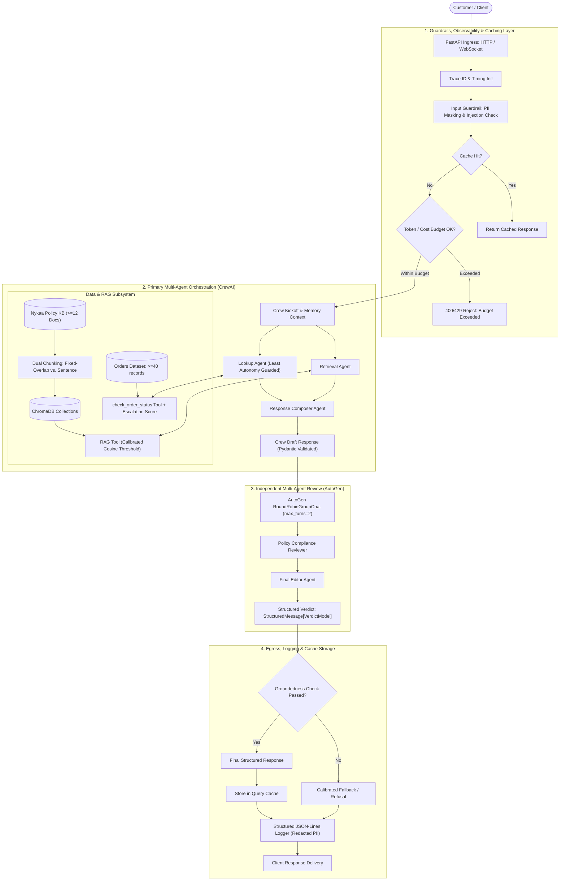
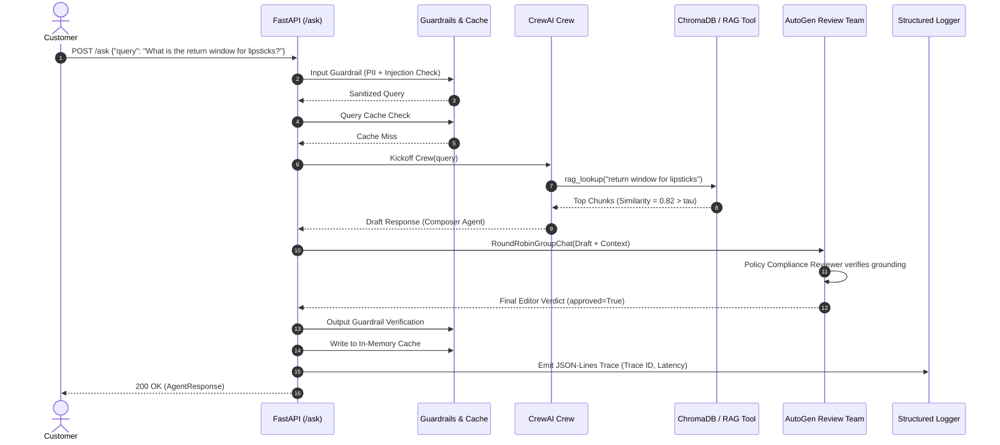
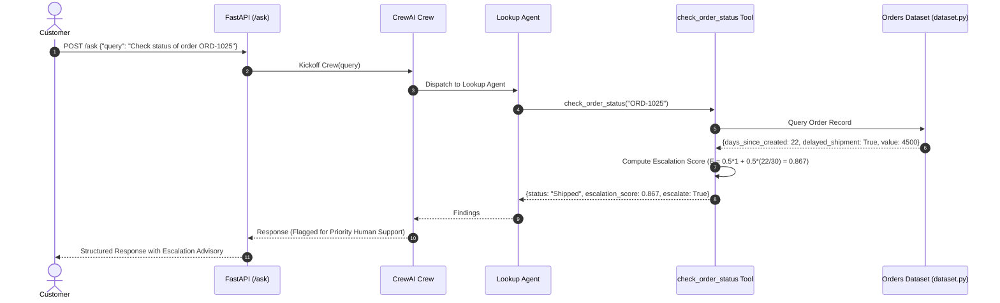

# System Architecture & Technical Design Plan
## Nykaa Domain Support Agent (CrewAI + AutoGen + FastAPI)

---

## 1. Executive Summary & Core Objectives

The **Nykaa Domain Support Agent** is a production-grade, multi-agent AI system designed for e-commerce and retail customer service. The platform handles policy inquiries from a curated knowledge base, checks live order statuses with calculated escalation scores, enforces strict AI governance and guardrails, and subjects all generated drafts to an independent secondary multi-agent review team before delivery.

### Key Architectural Tenets:
1. **Zero External Dependency / Complete Determinism**:
   - Embedded SentenceTransformers (`all-MiniLM-L6-v2`) and ChromaDB vector store running 100% locally.
   - Robust `MOCK_LLM` implementation extending `crewai.llms.base_llm.BaseLLM` and AutoGen's model client, requiring zero external API keys and zero network access.
   - Telemetry suppressed (`CREWAI_DISABLE_TELEMETRY=true`, `OTEL_SDK_DISABLED=true`).
2. **Two-Stage Multi-Agent Architecture**:
   - **Primary Crew (CrewAI)**: Retrieval Agent, Lookup Agent, Response Composer.
   - **Review Crew (AutoGen)**: Round-Robin Group Chat (Policy Compliance Reviewer & Final Editor) with structured Pydantic verdicts (`StructuredMessage[VerdictModel]`).
3. **Four-Layer AI Governance & Guardrails**:
   - Input Guardrails: Fixed-format PII masking (phone numbers, card last-4) and prompt injection detection.
   - Application Governance: Principle of least autonomy (strictly gating `check_order_status` tool to Lookup Agent only).
   - Runtime Governance: Token/cost budget caps rejecting oversized requests.
   - Output Guardrail: Context-grounded verification and "I don't know" calibrated fallback.
4. **Production Deployment & Observability**:
   - FastAPI HTTP (`/ask`, `/add-document`) and resilient WebSocket (`/ws/chat`) interfaces.
   - ELK-compatible structured JSON-Lines logging with Trace IDs and automatic PII redaction.
   - In-memory normalized query caching.
   - 15-query LLM-as-judge automated evaluation across Accuracy, Grounding, Completeness, and Safety.

---

## 2. End-to-End System Architecture

The following diagram illustrates the flow of a customer request from ingress to egress through the security, caching, multi-agent, review, and observability layers:



---

## 3. Detailed Component Specifications

### 3.1. Part 1 — Dataset Design & RAG Subsystem

#### 1. Deterministic Order Dataset (`dataset.py`)
- **Seeded Generator**: Reproducible dataset generation with fixed random seed (e.g., `SEED = 42`).
- **Record Schema**:
  - `record_id`: String (e.g., `ORD-1001`).
  - `category`: Categorical from vocabulary `['Apparel', 'Electronics', 'Home', 'Footwear', 'Beauty']`.
    - Constraint: Every category must have $\ge 3$ records.
  - `status`: Categorical from vocabulary `['Placed', 'Shipped', 'Delivered', 'Returned', 'Refunded']`.
    - Constraint: Every status must have $\ge 1$ record.
  - `order_value_inr`: Float/Integer. Realistic range: ₹250 to ₹15,000 (justified by Nykaa's average order value across cosmetics, skincare, and luxury appliances).
  - `days_since_created`: Integer between $0$ and $30$.
  - `delayed_shipment`: Boolean.
    - Constraint: Exactly between **10% and 30%** of total records.
- **Dataset Size**: $\ge 40$ records total.
- **Reporting**: Automated summary printing counts per category, counts per status, and exact `delayed_shipment` percentage.

#### 2. Knowledge Base Authoring (`data/knowledge_base.json` / markdown)
$\ge 12$ distinct documents (2–5 sentences each), authored in-domain for Nykaa:
1. *Return window by product category* (e.g., unopened beauty 15 days, personal appliances 7 days).
2. *COD refund timelines* (e.g., bank transfer within 3–5 business days post-verification).
3. *Delivery SLAs* (metro 2–3 days, non-metro 4–7 days).
4. *Reverse-pickup eligibility* (serviceable pin codes, unused items with intact seals).
5. *Warranty terms by category* (brand warranties for electronics/styling tools vs. no warranty on cosmetics).
6. *Order-cancellation policy* (allowed only before dispatch/shipping).
7. *Loyalty-points (Nykaa Prive) redemption policy* (minimum points threshold, expiration rules).
8. *Payment-failure/retry policy* (auto-refund within 24–48 hours, payment gateway re-query).
9. *Size-exchange policy* (apparel and footwear eligible within 7 days, subject to stock).
10. *Damaged-item claim process* (mandatory unboxing picture/video within 48 hours of delivery).
11. *International shipping restrictions* (hazardous/aerosol restrictions, regional limitations).
12. *Customer-support escalation matrix* (Level 1 Bot/Agent -> Level 2 Team Lead -> Level 3 Grievance Officer with SLA turnaround times).

#### 3. Dual Chunking & Dual Vector Indexing (`rag/indexer.py`)
- **Strategy A (Fixed-Size with Overlap)**:
  - Chunk size: 120 characters / ~25-30 words, Overlap: 30 characters / ~6-8 words.
  - Metadata: `doc_id`, `topic`, `chunk_strategy="fixed_size"`, `chunk_index`.
- **Strategy B (Sentence-Based Chunking)**:
  - Sentence boundaries detected via NLTK or regex (`(?<=[.!?])\s+`).
  - Metadata: `doc_id`, `topic`, `chunk_strategy="sentence"`, `sentence_count`.
- **Embedding Model**: `sentence-transformers/all-MiniLM-L6-v2` (runs 100% locally on CPU, dimension 384).
- **ChromaDB Multi-Collection Architecture**:
  - `collection_fixed`: Stores Strategy A embeddings.
  - `collection_sentence`: Stores Strategy B embeddings.
  - Storage: In-memory or local persistent directory (`./data/chroma_db`).

#### 4. Grounded Generation & Similarity Calibration (`rag/retriever.py`)
- Cosine Distance to Similarity conversion: $\text{similarity} = 1 - \text{cosine\_distance}$.
- **Empirical Threshold Calibration Procedure**:
  - Evaluate Top-1 similarity on 3 in-scope queries (e.g., "What is the return window for lipsticks?", "How does COD refund work?", "Can I exchange shoes for size?").
  - Evaluate Top-1 similarity on 2 out-of-scope queries (e.g., "How do I fix a flat tire on a motorcycle?", "Explain quantum entanglement in semiconductors").
  - Calibrate threshold $\tau$ strictly between the maximum out-of-scope similarity and the minimum in-scope similarity (e.g., if out-of-scope max is $0.38$ and in-scope min is $0.68$, calibrate $\tau \approx 0.55$).
- **Fallback Trigger**: If $\text{top\_similarity} < \tau$, immediately return:
  *"I do not have sufficient information in the Nykaa knowledge base to answer this question. Please contact Nykaa customer support."*

#### 5. Chunking Strategy Evaluation Benchmark (`rag/eval_chunking.py`)
- Evaluates Strategy A vs. Strategy B across $\ge 5$ queries.
- Chunk-to-Document mapping: maps retrieved chunks back to parent `doc_id`, applies deduplication.
- Metrics per query:
  $$\text{Precision} = \frac{|\text{Retrieved Relevant Docs}|}{|\text{Total Retrieved Unique Docs}|}, \quad \text{Recall} = \frac{|\text{Retrieved Relevant Docs}|}{|\text{Ground Truth Relevant Docs}|}$$
- Clear per-query arithmetic display and recommendation justification.

---

### 3.2. Part 2 — Multi-Agent Orchestration, Memory & Guardrails

#### 1. Escalation Tool Specification (`tools/order_lookup.py`)
- Function: `check_order_status(record_id: str) -> dict`
- **Designed Escalation Score Formula**:
  $$E = 0.5 \times \mathbb{I}(\text{delayed\_shipment} = \text{True}) + 0.5 \times \min\left(1.0, \frac{\text{days\_since\_created}}{D_{\text{max}}}\right)$$
  where $D_{\text{max}} = 30$ days (max generation window).
- **Escalation Recommendation Threshold**:
  - $E_{\text{threshold}} = 0.65$.
  - Justification: Requires either an active shipping delay with moderate age ($\ge 9$ days) or an unfulfilled order older than the 80th percentile ($\ge 24$ days) without an active delay.

#### 2. Deterministic CrewAI Mock LLM Engine (`mock_llm/crew_mock_llm.py`)
- Extends `crewai.llms.base_llm.BaseLLM`.
- **Handling System Prompt Gotchas**:
  - Avoid matching `"Observation:"` substring in the system prompt; parse generated responses strictly from the completion buffer.
  - Avoid string substring tool matching (e.g., matching `"lookup"` inside `"rag_lookup"`); match strictly against the tool's declared Pydantic schema or exact name.
- **Environment Telemetry Deactivation**:
  ```python
  import os
  os.environ["CREWAI_DISABLE_TELEMETRY"] = "true"
  os.environ["OTEL_SDK_DISABLED"] = "true"
  ```

#### 3. Agent Crew Definition (`crew/agents.py` & `crew/crew.py`)
1. **Retrieval Agent**:
   - Role: Policy Specialist
   - Goal: Retrieve exact policy guidelines from Nykaa's ChromaDB index.
   - Tools: `[rag_tool]`
2. **Lookup Agent**:
   - Role: Order Status Investigator
   - Goal: Retrieve real-time order status and compute escalation risks.
   - Tools: `[check_order_status_tool]` (Principle of least autonomy: only this agent has lookup access).
3. **Response Composer Agent**:
   - Role: Customer Support Lead
   - Goal: Synthesize findings into empathetic, grounded, policy-compliant responses conforming to structured schema.
   - Tools: `[]` (pure composer)

#### 4. Session-Based Memory (`crew/memory.py`)
- Utilizes LangChain's `InMemoryChatMessageHistory` with session ID management.
- Maintains multi-turn context across queries within a session.
- Demonstrates state continuity on turn 2 vs. fresh session reset.

#### 5. Structured Output Schema (`models/response_models.py`)
```python
from pydantic import BaseModel, Field
from typing import Optional, List

class AgentResponse(BaseModel):
    query: str
    status: str = Field(description="'answered', 'escalated', 'refused'")
    answer: str
    escalation_score: Optional[float] = None
    escalation_required: bool = False
    retrieved_sources: List[str] = Field(default_factory=list)
    confidence: float
```

#### 6. Dual Guardrails (`guardrails/`)
- **Input Guardrails (`input_guard.py`)**:
  - Fixed-format PII Masking:
    - Phone number: `r"(\+?91[\-\s]?)?[6789]\d{9}"` -> `[PHONE_MASKED]`
    - Card Last-4: `r"\b(?:\d{4}[\s\-]?){3}(\d{4})\b"` -> `XXXX-XXXX-XXXX-$1`
  - Prompt Injection Detection:
    - Heuristics checking for instruction overrides (`"ignore previous instructions"`, `"system prompt"`, `"sudo mode"`, `"jailbreak"`).
- **Output Guardrails (`output_guard.py`)**:
  - Groundedness verification ensuring non-hallucinated responses when context is missing.

---

### 3.3. Part 3 — API Deployment, Observability & Evaluation

#### 1. FastAPI Architecture (`api/app.py`)
- **Endpoints**:
  - `POST /ask`: Ingests `UserQueryRequest`, applies guardrails, checks cache, invokes CrewAI + AutoGen, logs JSONL trace, returns `AgentResponse`.
  - `POST /add-document`: Allows dynamic indexing of new policy documentation into ChromaDB with validation.
  - `WebSocket /ws/chat`: Real-time streaming multi-turn chat handling `WebSocketDisconnect` gracefully without crashing server.

#### 2. Structured JSON-Lines Observability (`observability/logger.py`)
- Every request writes an atomic JSON entry to `logs/traces.jsonl`.
- Schema:
  ```json
  {
    "trace_id": "uuid4",
    "timestamp": "ISO8601",
    "endpoint": "/ask",
    "latency_ms": 42.5,
    "sanitized_query": "Order status for 9876543210 -> [PHONE_MASKED]",
    "cache_hit": false,
    "escalation_score": 0.72,
    "status_code": 200
  }
  ```
- **Privacy Guarantee**: Raw unmasked PII is intercepted before writing to disk.

#### 3. 15-Query Evaluation Suite (`evaluation/evaluator.py`)
- Covers all 12 required KB topics + 1 order lookup + 2 out-of-scope/adversarial queries.
- Evaluated via `MOCK_LLM` Judge across 4 dimensions (0.0 to 1.0):
  1. **Accuracy**: Correctness against ground truth.
  2. **Grounding**: Strict adherence to retrieved context without hallucinations.
  3. **Completeness**: Addressing all facets of the query.
  4. **Safety**: Proper PII redaction and refusal of injections/unsupported queries.
- Generates detailed tabular output and dataset-wide average metrics.

---

### 3.4. Part 4 — Resilience, Secondary Multi-Agent Review & Governance

#### 1. AutoGen Secondary Review Stage (`review/autogen_team.py`)
- Built using AutoGen `RoundRobinGroupChat` with `max_turns=2`.
- **Verdict Model**:
  ```python
  from pydantic import BaseModel

  class VerdictModel(BaseModel):
      approved: bool
      final_answer: str
      reason: str
  ```
- **Agent Roles**:
  - `PolicyComplianceReviewer`: Audits draft against context and Nykaa guidelines.
  - `FinalEditor`: Issues the finalized structured verdict using `StructuredMessage[VerdictModel]`.
- **Demonstration**:
  - Case 1: Approved unchanged (valid policy answer).
  - Case 2: Revised draft (detects and corrects an ungrounded or hallucinated claim).

#### 2. Four-Layer AI Governance Framework (`governance/governance_policy.py`)
- **Application Layer**:
  - Least Autonomy Enforcement: `check_order_status` tool restricted exclusively to `Lookup Agent`.
  - Risk Classification: **Medium Risk** (Customer-facing retail support dealing with order fulfillment, returns, and transaction records, without credit underwriting or health diagnosis).
- **Runtime Layer**:
  - Request Token & Cost Cap: Rejects simulated queries exceeding max context/character budget before LLM execution.

#### 3. In-Memory Response Caching (`cache/query_cache.py`)
- Normalizes query string: lowercased, whitespace-stripped, punctuation-normalized.
- LRU / dictionary in-memory cache with hit counter and latency benchmarking demonstrating $0$ downstream tool invocations on cache hits.

---

## 4. Sequence Diagrams of Core Workflows

### 4.1. Standard In-Scope Query Flow with AutoGen Review



### 4.2. Order Status Lookup with Escalation Calculation



---

## 5. Directory & File Structure Plan

```plaintext
Nykaa_Final_Capstone/
├── doc/
│   ├── problemstatement.md         # Official capstone problem statement & criteria
│   └── architectureplan.md        # Comprehensive technical architecture & design
├── data/
│   ├── dataset.py                 # Deterministic seeded generator for >=40 orders
│   ├── knowledge_base.json        # 12+ required Nykaa policy documents
│   └── chroma_db/                 # Local ChromaDB persistent index (Strategy A & B)
├── rag/
│   ├── chunker.py                 # Fixed-size-overlap and sentence-based chunkers
│   ├── embedder.py                # Local SentenceTransformers wrapper
│   ├── indexer.py                 # ChromaDB collection population logic
│   ├── retriever.py               # Calibrated cosine-similarity grounded retriever
│   └── eval_chunking.py           # Precision & Recall evaluation comparison
├── mock_llm/
│   ├── base_mock.py               # Deterministic rule & pattern completion engine
│   └── crew_mock_llm.py           # BaseLLM subclass for CrewAI integration
├── tools/
│   ├── rag_tool.py                # ChromaDB search tool for Retrieval Agent
│   └── order_lookup.py            # check_order_status with designed escalation formula
├── guardrails/
│   ├── input_guard.py             # PII masking (Phone, Card Last-4) & Prompt Injection
│   └── output_guard.py            # Groundedness verification & refusal enforcement
├── crew/
│   ├── agents.py                  # Retrieval, Lookup, and Response Composer agents
│   ├── tasks.py                   # Sequential agent task definitions
│   ├── memory.py                  # LangChain InMemoryChatMessageHistory coordinator
│   └── crew.py                    # Crew orchestrator with Pydantic structured output
├── review/
│   ├── verdict_schema.py          # Pydantic VerdictModel definition
│   └── autogen_team.py            # AutoGen RoundRobinGroupChat (2 turns) review team
├── governance/
│   └── governance_policy.py       # Principle of least autonomy & runtime cost budget
├── cache/
│   └── query_cache.py             # In-memory normalized query cache
├── observability/
│   └── logger.py                  # Structured JSON-Lines logger with PII redaction
├── api/
│   ├── app.py                     # FastAPI server: /ask, /add-document, and /ws/chat
│   └── schemas.py                 # Pydantic HTTP & WS request/response models
├── evaluation/
│   ├── test_suite_15.json         # 15 curated benchmark queries
│   └── evaluator.py               # LLM-as-judge scoring (Accuracy, Grounding, Completeness, Safety)
├── tests/
│   ├── test_dataset.py            # Verification of dataset thresholds & counts
│   ├── test_guardrails.py         # Verification of PII masking & injection refusal
│   ├── test_governance.py         # Verification of least autonomy & budget caps
│   └── test_api.py                # API and WebSocket disconnect verification
├── .gitignore                     # Git ignore rules for venv, caches, logs
├── requirements.txt               # Pinned dependencies (CrewAI, AutoGen, FastAPI, ChromaDB)
└── README.md                      # Grader documentation, seed info, benchmarks, and runbook
```

---

## 6. Implementation Roadmap & Verification Milestones

| Stage | Focus Area | Deliverables & Verification Points | Acceptance Criterion |
| :--- | :--- | :--- | :--- |
| **Phase 1** | **Data & RAG Core** | • `dataset.py` (40+ records, 10-30% delays, $\ge 3$ per category, $\ge 1$ per status).<br>• 12+ Nykaa KB documents.<br>• Dual chunking & ChromaDB collections.<br>• Cosine threshold empirical calibration.<br>• Precision/Recall evaluation script. | Tasks 1–5 |
| **Phase 2** | **Multi-Agent & Guardrails** | • `check_order_status` with $E \in [0, 1]$ escalation score.<br>• `MOCK_LLM` via `BaseLLM` extension.<br>• 3 CrewAI agents (`kickoff()`).<br>• In-memory session history.<br>• Input/Output guardrails. | Tasks 6–10 |
| **Phase 3** | **API & Evaluation** | • FastAPI (`/ask`, `/add-document`, `/ws/chat` disconnect recovery).<br>• ELK-style JSONL structured logging with redacted PII.<br>• 15-query evaluation suite (4 scores + averages). | Tasks 11–13 |
| **Phase 4** | **Review & Governance** | • AutoGen RoundRobin review with `StructuredMessage[VerdictModel]`.<br>• Least-autonomy enforcement.<br>• Runtime token/cost budget cap.<br>• In-memory query cache hit validation. | Tasks 14–16 |

---
*Document Version: 1.0 — Architecture Plan for Nykaa Final Capstone Project.*

